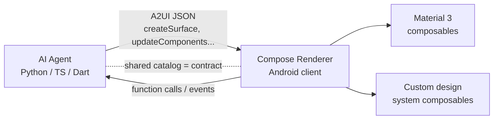

## 🎣 The day my agent answered with a wall of text

I remember the afternoon I wired my first agent into a real Android app. I asked it to "book a flight to Barcelona next Friday," and instead of a button I could tap, I got a 400-word paragraph listing options, prices, and confirmation links. The user had to read, parse, and act on text. That is the **wall of text** problem, and it is the single biggest UX bottleneck in agent-driven apps today. I have shipped three agent features since then, and every single one of them started with that same frustrating realization: the agent is smart, but the surface it talks through is dumb.

**A2UI 1.0** solves it. Released by Google on November 11, 2026, A2UI (Agent-to-UI) is an open protocol that lets an AI agent describe *what* to show on screen, while the client app decides *how* to render it using its own native components. The agent never ships code. It ships a declarative description of a UI, and the app renders it with Jetpack Compose, SwiftUI, Flutter, or React — natively, with full platform fidelity. In this article I walk through the protocol, the new Jetpack Compose renderer, and a small agent-generated form built end to end in Kotlin. I will be honest about what is alpha, what is illustrative, and what I still have not verified hands-on.

If you have read my earlier pieces on [AI agents on Android](/blog/ai-agents-android-theory/) and [agent workflows in real Android projects](/blog/ai-agents-workflow-android/), this is the natural next chapter: those articles covered the brain and the workflow; this one covers the face.

---

## 🧩 What is A2UI?

A2UI is a **declarative, JSON-based UI protocol** for agent-driven interfaces. Think of it as a shared contract between two sides:

- **The agent** (server side, usually Python, TypeScript, or Dart) decides that the user needs a form, a chart, or a confirmation card. It emits a small JSON payload describing the components and their data.
- **The renderer** (client side, running on the device) receives that payload and instantiates native widgets from a pre-approved **component catalog**.

Three ideas make this powerful, and I keep coming back to them whenever I evaluate a new agent UI approach:

1. **Native rendering, not web rendering.** The agent describes a "button" semantically. The Compose renderer turns it into a real `Button` composable with your Material 3 theme, your typography, and your ripple. No WebView, no HTML, no CSS, no JavaScript bridge latency.
2. **No arbitrary code execution.** The agent cannot run JavaScript or ship a binary. It can only reference component types that the renderer already knows about. This is the security foundation of the whole protocol, and it is the reason I stopped being nervous about agent-generated UI.
3. **Decoupled branding.** The agent never hardcodes colors, fonts, or spacing. It says "primary action button" and the renderer applies the app's design system. The same agent payload looks like my app on Android and like a different app on iOS. That is a huge deal for anyone shipping on more than one platform.

> 💡 **Mental model:** A2UI is to agent UI what JSON is to REST APIs — a neutral, declarative wire format that both sides agree on, with the client keeping full control over presentation.

### Why not just generate HTML?

I tried the HTML route first. It works for a demo, but it breaks down fast: a WebView is heavy, the agent can ship a `<script>` tag, accessibility depends on whatever markup the model hallucinates, and every brand tweak requires re-prompting the model. A2UI moves the presentation decision to the client, where it belongs. The agent stays focused on *intent*; the app stays focused on *look and feel*.

---

## 🏗️ Architecture: The Component Catalog Contract

The heart of A2UI is the **component catalog**. A catalog is a registry of component types the renderer knows how to draw, each with a JSON schema describing its props. The agent and the renderer must agree on a catalog before any UI can flow. I think of it as the API contract between my agent and my app: if the agent uses a type that is not in the catalog, the renderer refuses it.



Key architectural pieces I had to internalize before the protocol clicked:

- **Surface.** A surface is the canonical container for a piece of agent UI. Every surface has a `child="root"` entry point. You can have multiple surfaces — one for a chat bubble, one for a modal, one for an inline card — and they are independent.
- **Adjacency list.** Components reference each other by ID, not by nesting. A `Column` lists its children as `["title", "subtitle", "cta"]`. This flat structure makes diffs, patches, and streaming trivial, and it is the reason incremental updates feel cheap.
- **Progressive rendering.** If a component references an ID that has not arrived yet, the renderer shows a placeholder instead of crashing. This is what makes streaming UI feel smooth while the agent is still thinking.
- **`catalogId`.** A string (conventionally a URI) identifying which catalog the payload targets. The renderer validates that it supports that catalog before rendering anything. I pin the allowed catalogs in the app; the agent only picks components inside them.

The agent is **constrained**: it may only emit component types present in the catalog. If it hallucinates a `MagicChart` that does not exist, the renderer drops it and reports an error back to the agent for self-correction. That feedback loop is, in my opinion, the most underrated feature of the whole protocol — it turns a hallucination into a retry instead of a crash.

---

## 📨 The A2UI Message Protocol

A2UI 1.0 defines four core messages that flow from agent to renderer:

| Message | Purpose |
|---|---|
| `createSurface` | Creates a surface, optionally with initial `components` and `dataModel` |
| `updateComponents` | Adds or replaces components in a surface (adjacency list) |
| `updateDataModel` | Patches data at a JSON Pointer path |
| `deleteSurface` | Removes a surface and its components |

And four bidirectional function-call messages for interactivity:

| Message | Direction | Purpose |
|---|---|---|
| `callRendererFunction` | agent → renderer | Ask the renderer to do something (e.g., show a toast) |
| `callAgentFunction` | renderer → agent | User action triggers an agent tool call |
| `rendererFunctionResponse` | renderer → agent | Result of a renderer function |
| `agentFunctionResponse` | agent → renderer | Result of an agent function |

Two protocol details worth knowing, because they shaped how I structure my payloads:

- **Single-message instantiation.** `createSurface` can carry both `components` and `dataModel` in one message, so an entire form can appear in a single frame. This matters on mobile, where every round trip costs latency and battery.
- **Reliable delivery.** Messages arrive in order. The renderer applies them sequentially, which keeps state predictable even over flaky networks. I have lost count of the bugs I have debugged that were really "messages arrived out of order" problems.

Envelope keys are prefixed with `@` (`@catalogId`, `@accessibility`, `@metadata`, `@checks`), and dynamic bindings use `@` too (`@path` for data binding, `@call` for function calls). Naming follows strict Unicode rules (UAX #31), so component IDs are safe to use as identifiers across languages. If you have ever fought a non-ASCII identifier bug in a multi-language codebase, you will appreciate that detail.

---

## 📱 Jetpack Compose A2UI Renderer

On the Android side, Google shipped the **Jetpack Compose A2UI renderer** as `1.0.0-alpha02`. The renderer targets **A2UI spec v0.9.1**; support for the v1.0 spec on Compose is coming soon. It is built on top of Compose's Snapshot state system, which gives it high reactivity: when the data model changes, affected composables recompose automatically. That last part is the reason I am excited — it means agent-driven UI gets the same recomposition discipline as hand-written Compose, instead of a full re-render on every update.

### Artifacts

```kotlin
// build.gradle.kts (app module)
// Note: verify the exact artifact coordinates against the official AndroidX
// release notes before shipping; these are the coordinates published for
// 1.0.0-alpha02.
dependencies {
    implementation("androidx.compose.material3:material3-a2ui:1.0.0-alpha02")
    implementation("androidx.a2ui.compose:compose-runtime:1.0.0-alpha02")
    implementation("androidx.a2ui.compose:compose-ui:1.0.0-alpha02")
    implementation("androidx.a2ui:a2ui-model:1.0.0-alpha02")
    implementation("androidx.a2ui:a2ui-engine:1.0.0-alpha02")
}
```

You will also need the Google Maven repository available (it usually is, but double-check if you are on a restricted mirror). The **Basic Catalog** ships Material 3 components (`Button`, `Text`, `Column`, `Row`, `TextField`, `Card`, `Image`, …) via `material3-a2ui`, so you get a working UI out of the box. For your own design system, you can register a **custom catalog** with your own composables — that is the path I plan to take for my apps, because Material 3 alone never matches my brand.

### Key capabilities

- **Schema validation.** Every incoming payload is validated against the catalog schema *before* it touches state models. Malformed payloads are rejected, not rendered. This is the line of defense between a hallucinating model and my production UI.
- **Graceful hallucination handling.** Unknown component types are skipped and reported; the rest of the surface still renders. I love this: a single bad type no longer takes down the whole screen.
- **Auto-reporting errors to the agent.** Validation failures and render errors are sent back as function calls, letting the agent self-correct on the next turn. This closes the loop without me writing retry logic.
- **Reactive data binding.** `updateDataModel` patches flow straight into Compose state, triggering recomposition only where needed.

One caveat I want to be upfront about: the Compose renderer is alpha. The public API names in the snippets below are **illustrative** — they reflect the documented concepts (`A2uiSurface`, `materialA2uiBasicCatalogV1(...)`, `A2uiCatalog`, `A2uiMessageParser`, `A2uiMessageProcessor`, with the public `A2ui` prefix), but you should verify exact signatures against the [official client integration guide](https://developer.android.com/develop/ui/compose/agentic) before copying them into production. I would rather you trust the docs than my blog post.

---

## 🛠️ Implementation: A Working Agent-Generated Form

Let me build a minimal example: an agent generates a "confirm booking" form, the user fills it, and tapping submit calls back into the agent. The code is illustrative Kotlin — it shows the shape of the integration, not a compilable module. Treat it as a map, not a copy-paste.

### 1. Set up the renderer host

```kotlin
// BookingScreen.kt (illustrative)
@Composable
fun BookingScreen(
    agentClient: AgentClient,
    modifier: Modifier = Modifier,
) {
    // Pseudocode: obtain an engine bound to the Basic Catalog.
    // Real API: see A2uiMessageProcessor + materialA2uiBasicCatalogV1(...)
    val engine = rememberA2uiEngine(
        catalog = Material3BasicCatalog,
        onAgentFunctionCall = { call ->
            // Forward user actions to the agent
            agentClient.callFunction(call)
        },
    )

    // Collect the agent's UI stream
    val surfaces by engine.surfaces.collectAsState()

    Column(modifier = modifier.fillMaxSize().padding(16.dp)) {
        surfaces.forEach { surface ->
            A2uiSurface(surface = surface, engine = engine)
        }
    }

    // Kick off the agent turn when the screen opens
    LaunchedEffect(Unit) {
        agentClient.sendMessage("Show a booking confirmation form for flight BCN-2026-11-21")
    }
}
```

### 2. What the agent sends

The agent (Python, in this example) emits a single `createSurface` message carrying components and data. Note: the payload below uses **v1.0-style** features (components + dataModel embedded in `createSurface`, plus `@path`/`@call` bindings). Since the Compose renderer currently targets v0.9.1, treat this as the **target shape once Compose supports v1.0**; on v0.9.1 you would send the components and data model as separate messages.

```json
{
  "createSurface": {
    "surfaceId": "booking-form",
    "catalogId": "https://a2ui.org/catalogs/material3-basic/v1",
    "components": [
      { "id": "root", "type": "Column", "children": ["title", "flight", "nameField", "submitBtn"] },
      { "id": "title", "type": "Text", "text": "Confirm your booking", "style": "headlineMedium" },
      { "id": "flight", "type": "Text", "text": "Flight BCN-2026-11-21 · 09:30", "style": "bodyLarge" },
      { "id": "nameField", "type": "TextField", "label": "Passenger name", "value": { "@path": "/passengerName" } },
      { "id": "submitBtn", "type": "Button", "label": "Confirm booking", "action": { "@call": "confirmBooking" } }
    ],
    "dataModel": {
      "passengerName": ""
    }
  }
}
```

Notice the `@path` and `@call` bindings: the text field is bound to `/passengerName` in the data model, and the button triggers the `confirmBooking` agent function with the current form values. That two-way binding is what turns a static card into an actual form.

### 3. Handling the callback in Kotlin

When the user taps "Confirm booking," the renderer fires `callAgentFunction` with the form data. Your agent then runs the booking tool and streams back a new surface — say, a success card — which replaces the form.

```kotlin
// Inside your AgentClient / ViewModel (illustrative)
suspend fun onAgentFunction(call: AgentFunctionCall) {
    when (call.name) {
        "confirmBooking" -> {
            val name = call.args["passengerName"] as? String ?: return
            val result = bookingService.confirm(name, flightId = "BCN-2026-11-21")
            // Stream the result back; the agent will emit a new surface
            agent.sendToolResult(call.id, result)
        }
    }
}
```

### 4. Custom catalog for your design system

If Material 3 is not enough, register your own components:

```kotlin
// Illustrative
val ArceCatalog = A2uiCatalog(
    id = "https://arceapps.com/catalogs/arce/v1",
    components = mapOf(
        "ArceCard" to ArceCardComponent,   // your composable
        "ArceChart" to ArceChartComponent,
    ),
)
```

The agent must then reference `"type": "ArceCard"` and the renderer will use your composable, your colors, your animation. The agent still has no idea what `ArceCard` looks like — it just knows it exists and what props it accepts. That separation is the whole point: my design system stays mine, and the agent stays a content producer.

---

## 🔒 Security: Why A2UI Beats HTML Generation

Before A2UI, the common approach was to have the agent generate HTML/JSX and render it in a WebView. I went down that road and regretted it. That approach has three well-known problems, and A2UI addresses each:

| Concern | HTML/JSX generation | A2UI |
|---|---|---|
| **Arbitrary code execution** | Agent can ship `<script>`; XSS risk | Agent only references catalog types; no code runs |
| **Schema safety** | No validation; malformed markup breaks the view | Payload validated against catalog schema before state update |
| **Sensitive data** | Often sent to the model in full | Data binding is server-side; sensitive values never reach the model |
| **Branding** | Agent hardcodes CSS/colors | Renderer applies native theme; agent stays brand-agnostic |
| **Performance** | WebView overhead, JS bridge latency | Native Compose recomposition, Snapshot-driven |
| **Accessibility** | Depends on generated markup quality | Renderer controls semantics; `@accessibility` envelope hints |

Additional safeguards in the Compose renderer:

- **Error states.** A component that fails to render shows a graceful error placeholder instead of crashing the screen.
- **Auto-reporting.** Render and validation errors are sent back to the agent as function responses, enabling self-correction on the next turn.
- **Catalog allow-listing.** You decide which catalogs the renderer accepts. An agent targeting an unknown `catalogId` is ignored.

> ⚠️ **Rule of thumb:** Never let the agent choose the catalog. The app pins the allowed catalogs; the agent only picks among the components inside them. I treat this as non-negotiable in my own apps, the same way I treat "never trust client input" on a backend.

---

## 📊 When to Use A2UI (and When Not To)

| Scenario | A2UI? | Why |
|---|---|---|
| Agent-driven forms, confirmations, wizards | ✅ Yes | Structured, interactive, native feel |
| Dynamic charts/dashboards generated by agent | ✅ Yes | Custom catalog components for viz |
| Adaptive UI per user segment | ✅ Yes | Same payload, different native theme |
| Streaming progress while agent works | ✅ Yes | Progressive rendering + placeholders |
| Static marketing copy | ❌ No | Plain text is simpler and cheaper |
| Pixel-perfect custom animations | ⚠️ Maybe | Needs custom catalog; consider Compose directly |
| Offline-only, no agent round-trip | ❌ No | Overhead without benefit |

I have a simple heuristic: if the agent's answer would contain a button, a form, or a chart, reach for A2UI. If it is prose, keep it prose. Anything in between, ask whether the interaction earns the complexity.

---

## 🌍 Adoption and Ecosystem

A2UI is not a Google-only experiment. Companies including **Atlassian, Bloomberg, and ByteDance** are already building with it, and the ecosystem is growing fast:

- **Agent SDKs** in Python, TypeScript, and Dart.
- **Web renderers** for React, Angular, and Lit — and they run inside **MCP Apps** (Claude, Gemini), so the same agent can target multiple hosts without a rewrite.
- **A2UI Macros** for programmatic expansion of component trees in Python.
- **A2UI Express** for rapid UI generation scaffolding.

For Android teams, the Compose renderer is the missing piece: it brings the same agent-driven UI model to native mobile, with Material 3 out of the box and a path to custom design systems. As someone who ships Android apps as an indie, having a first-party renderer matters more to me than any spec detail — it means I am not maintaining a WebView shim for the next three years.

---

## 🧠 Lecciones aprendidas (Lessons I learned the hard way)

A few trade-offs I want to put on the table before you adopt this:

1. **Alpha tax.** `1.0.0-alpha02` is alpha. APIs will move, and the Compose renderer only speaks v0.9.1 while the spec is at v1.0. If you ship to production today, you are signing up to migrate. I am comfortable with that for a side project; I would not bet a client's release on it yet.
2. **Catalog design is the real work.** Writing the renderer host takes an afternoon. Designing a catalog that is expressive enough for your agent but constrained enough to stay safe takes weeks. Budget for that.
3. **Prompt engineering moves to the catalog.** Half of my prompt work is now "here is the catalog, here are the allowed types, never invent a new one." That is a different skill from writing good prompts, and it took me a while to notice.
4. **Debugging is two-sided.** When a surface looks wrong, the bug can be in the agent's JSON, in the catalog schema, or in the composable. I added logging on both sides early and it saved me hours.
5. **Alternatives I considered.** Generating Compose code directly (rejected: code execution risk and no validation), a WebView with a design-system CSS (rejected: performance and accessibility), and Flutter (viable if you are already on Flutter — the renderer exists). For a Compose-first Android app, A2UI is the cleanest fit I have found.

---

## 📚 Bibliografía y Referencias

Fuentes oficiales y artículos relacionados del blog:

### Fuentes oficiales
- [A2UI specification v1.0](https://a2ui.org) — protocol spec and catalog definitions
- [A2UI — Build delightful, fast, reliable agentic experiences (Google Developers Blog)](https://developers.googleblog.com/en/a2ui-10-build-delightful-fast-reliable-agentic-experiences/) — official announcement (Nov 11, 2026)
- [Jetpack Compose A2UI client integration guide](https://developer.android.com/develop/ui/compose/agentic) — renderer setup and API guidance
- [AndroidX A2UI Compose releases](https://developer.android.com/jetpack/androidx/releases/a2ui-compose) — release notes and version history
- [Jetpack Compose November 2026 release (Android Developers Blog)](https://developer.android.com/blog/posts/jetpack-compose-november-2026-release) — Compose context and release cadence

### Artículos relacionados en este blog
- [AI Agents on Android: Theory and Practice](/blog/ai-agents-android-theory/) — foundations of agents on mobile
- [Asynchronous Pair Programming with Agents](/blog/ai-agents-workflow-android/) — real agent workflows in Android projects
- [Google Stitch: Android Guide](/blog/google-stitch-android-guide/) — another Google tooling angle for Android devs
- [Compose Nav Graph Plugin: Visualization for Android](/blog/compose-nav-graph-plugin-visualization-android/) — Compose tooling deep dive

### Repositorios y ecosistema
- [A2UI GitHub organization](https://github.com/google/a2ui) — reference implementations and SDKs
- [Model Context Protocol (MCP) Apps](https://modelcontextprotocol.io) — host integration for web renderers

---

## 👋 Cierre

The wall of text era is ending, and I for one am glad. A2UI 1.0 gives agents a way to speak in UI instead of prose, and the Jetpack Compose renderer brings that to Android with Material 3 out of the box and a clean path to custom design systems. It is alpha, the API names will move, and the catalog work is the real investment — but the direction is right, and the security model (no code execution, schema validation, catalog allow-listing) is the part I trust most.

If you build something with A2UI on Compose, I would love to hear about your catalog design and your war stories. Drop a comment or reach out — and if you want more agent-side Android content, the [agent theory](/blog/ai-agents-android-theory/) and [workflow](/blog/ai-agents-workflow-android/) articles are the best starting points. 🚀