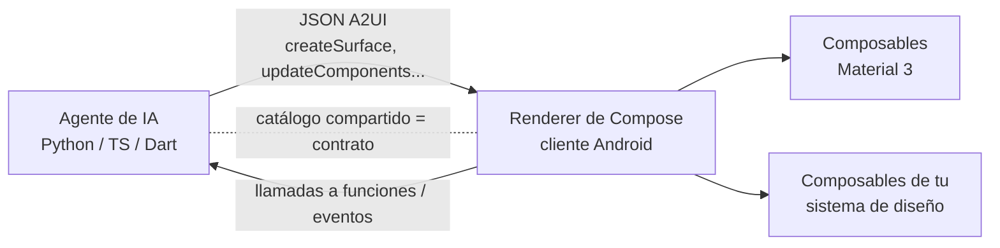

## 🎣 El día que mi agente me respondió con un muro de texto

Recuerdo la tarde en que conecté mi primer agente a una app Android real. Le pedí que "reservara un vuelo a Barcelona el próximo viernes" y, en vez de un botón que pudiera tocar, recibí un párrafo de 400 palabras listando opciones, precios y enlaces de confirmación. El usuario tenía que leer, parsear y actuar sobre texto. Ese es el problema del **muro de texto**, y es el mayor cuello de botella de UX en las apps dirigidas por agentes hoy en día. Desde entonces he lanzado tres funcionalidades con agentes, y todas empezaron con la misma frustración: el agente es inteligente, pero la superficie por la que habla es tonta.

**A2UI 1.0** lo resuelve. Lanzado por Google el 11 de noviembre de 2026, A2UI (Agent-to-UI) es un protocolo abierto que permite a un agente de IA describir *qué* mostrar en pantalla, mientras que la app cliente decide *cómo* renderizarlo usando sus propios componentes nativos. El agente nunca envía código. Envía una descripción declarativa de una UI, y la app la renderiza con Jetpack Compose, SwiftUI, Flutter o React — de forma nativa, con toda la fidelidad de la plataforma. En este artículo recorro el protocolo, el nuevo renderer de Jetpack Compose y un pequeño formulario generado por un agente, construido de extremo a extremo en Kotlin. Seré honesto sobre lo que es alpha, lo que es ilustrativo y lo que todavía no he verificado con las manos en el código.

Si has leído mis artículos anteriores sobre [agentes de IA en Android](/blog/ai-agents-android-theory/) y [workflows con agentes en proyectos reales](/blog/ai-agents-workflow-android/), este es el capítulo natural: aquellos cubrieron el cerebro y el flujo de trabajo; este cubre la cara.

---

## 🧩 ¿Qué es A2UI?

A2UI es un **protocolo de UI declarativo basado en JSON** para interfaces dirigidas por agentes. Piénsalo como un contrato compartido entre dos partes:

- **El agente** (lado servidor, normalmente Python, TypeScript o Dart) decide que el usuario necesita un formulario, un gráfico o una tarjeta de confirmación. Emite un pequeño payload JSON que describe los componentes y sus datos.
- **El renderer** (lado cliente, ejecutándose en el dispositivo) recibe ese payload e instancia widgets nativos a partir de un **catálogo de componentes** preaprobado.

Tres ideas hacen esto potente, y vuelvo a ellas cada vez que evalúo un nuevo enfoque de UI para agentes:

1. **Renderizado nativo, no web.** El agente describe un "botón" de forma semántica. El renderer de Compose lo convierte en un composable `Button` real con tu tema Material 3, tu tipografía y tu ripple. Sin WebView, sin HTML, sin CSS, sin latencia de puente JavaScript.
2. **Sin ejecución de código arbitrario.** El agente no puede ejecutar JavaScript ni enviar un binario. Solo puede referenciar tipos de componentes que el renderer ya conoce. Esta es la base de seguridad de todo el protocolo, y es la razón por la que dejé de ponerme nervioso con la UI generada por agentes.
3. **Branding desacoplado.** El agente nunca hardcodea colores, fuentes ni espaciados. Dice "botón de acción primaria" y el renderer aplica el sistema de diseño de la app. El mismo payload del agente se ve como mi app en Android y como una app distinta en iOS. Eso es enorme para quien publica en más de una plataforma.

> 💡 **Modelo mental:** A2UI es para la UI de agentes lo que JSON es para las APIs REST — un formato de cable neutral y declarativo en el que ambas partes se ponen de acuerdo, con el cliente manteniendo el control total de la presentación.

### ¿Por qué no simplemente generar HTML?

Probé primero la ruta del HTML. Funciona para una demo, pero se rompe rápido: un WebView es pesado, el agente puede enviar una etiqueta `<script>`, la accesibilidad depende del markup que el modelo alucine, y cada ajuste de marca requiere re-promptear al modelo. A2UI mueve la decisión de presentación al cliente, donde pertenece. El agente se centra en la *intención*; la app se centra en el *aspecto y la sensación*.

---

## 🏗️ Arquitectura: el contrato del catálogo de componentes

El corazón de A2UI es el **catálogo de componentes**. Un catálogo es un registro de tipos de componentes que el renderer sabe dibujar, cada uno con un esquema JSON que describe sus props. El agente y el renderer deben ponerse de acuerdo en un catálogo antes de que fluya ninguna UI. Lo pienso como el contrato de API entre mi agente y mi app: si el agente usa un tipo que no está en el catálogo, el renderer lo rechaza.



Piezas arquitectónicas clave que tuve que interiorizar antes de que el protocolo hiciera clic:

- **Superficie (Surface).** Una superficie es el contenedor canónico de un trozo de UI del agente. Toda superficie tiene un punto de entrada `child="root"`. Puedes tener varias superficies — una para una burbuja de chat, una para un modal, una para una tarjeta inline — y son independientes.
- **Lista de adyacencia (Adjacency list).** Los componentes se referencian por ID, no por anidamiento. Una `Column` lista sus hijos como `["title", "subtitle", "cta"]`. Esta estructura plana hace que los diffs, los parches y el streaming sean triviales, y es la razón por la que las actualizaciones incrementales se sienten baratas.
- **Renderizado progresivo.** Si un componente referencia un ID que aún no ha llegado, el renderer muestra un placeholder en lugar de romperse. Esto es lo que hace que el streaming de UI se sienta fluido mientras el agente sigue pensando.
- **`catalogId`.** Una cadena (convencionalmente una URI) que identifica a qué catálogo apunta el payload. El renderer valida que soporta ese catálogo antes de renderizar nada. Fijo los catálogos permitidos en la app; el agente solo elige componentes dentro de ellos.

El agente está **restringido**: solo puede emitir tipos de componentes presentes en el catálogo. Si alucina un `MagicChart` que no existe, el renderer lo descarta y reporta un error al agente para que se autocorrija. Ese bucle de feedback es, en mi opinión, la funcionalidad más infravalorada de todo el protocolo — convierte una alucinación en un reintento en vez de un crash.

---

## 📨 El protocolo de mensajes A2UI

A2UI 1.0 define cuatro mensajes principales que fluyen del agente al renderer:

| Mensaje | Propósito |
|---|---|
| `createSurface` | Crea una superficie, opcionalmente con `components` y `dataModel` iniciales |
| `updateComponents` | Añade o reemplaza componentes en una superficie (lista de adyacencia) |
| `updateDataModel` | Parchea datos en una ruta JSON Pointer |
| `deleteSurface` | Elimina una superficie y sus componentes |

Y cuatro mensajes de llamada a función bidireccionales para la interactividad:

| Mensaje | Dirección | Propósito |
|---|---|---|
| `callRendererFunction` | agente → renderer | Pide al renderer que haga algo (p. ej., mostrar un toast) |
| `callAgentFunction` | renderer → agente | Una acción del usuario dispara una llamada a herramienta del agente |
| `rendererFunctionResponse` | renderer → agente | Resultado de una función del renderer |
| `agentFunctionResponse` | agente → renderer | Resultado de una función del agente |

Dos detalles del protocolo que merece la pena conocer, porque moldearon cómo estructuro mis payloads:

- **Instanciación en un solo mensaje.** `createSurface` puede llevar tanto `components` como `dataModel` en un mensaje, así que un formulario entero puede aparecer en un solo frame. Esto importa en móvil, donde cada ida y vuelta cuesta latencia y batería.
- **Entrega fiable.** Los mensajes llegan en orden. El renderer los aplica secuencialmente, lo que mantiene el estado predecible incluso con redes inestables. He perdido la cuenta de los bugs que he depurado que en realidad eran problemas de "los mensajes llegaron fuera de orden".

Las claves del envelope van prefijadas con `@` (`@catalogId`, `@accessibility`, `@metadata`, `@checks`), y los bindings dinámicos también usan `@` (`@path` para data binding, `@call` para llamadas a función). Los nombres siguen reglas estrictas de Unicode (UAX #31), así que los IDs de componente son seguros para usar como identificadores a través de lenguajes. Si alguna vez has peleado con un bug de identificador no-ASCII en un codebase multilenguaje, apreciarás ese detalle.

---

## 📱 Renderer de Jetpack Compose para A2UI

En el lado Android, Google publicó el **renderer de Jetpack Compose para A2UI** como `1.0.0-alpha02`. El renderer apunta a la **spec A2UI v0.9.1**; el soporte para la spec v1.0 en Compose está por llegar. Está construido sobre el sistema de estado Snapshot de Compose, lo que le da alta reactividad: cuando el modelo de datos cambia, los composables afectados se recomponen automáticamente. Esa última parte es la razón por la que estoy emocionado — significa que la UI dirigida por agentes obtiene la misma disciplina de recomposición que el Compose escrito a mano, en vez de un re-render completo en cada actualización.

### Artefactos

```kotlin
// build.gradle.kts (módulo app)
// Nota: verifica las coordenadas exactas de los artefactos contra las notas
// oficiales de release de AndroidX antes de publicar; estas son las
// publicadas para 1.0.0-alpha02.
dependencies {
    implementation("androidx.compose.material3:material3-a2ui:1.0.0-alpha02")
    implementation("androidx.a2ui.compose:compose-runtime:1.0.0-alpha02")
    implementation("androidx.a2ui.compose:compose-ui:1.0.0-alpha02")
    implementation("androidx.a2ui:a2ui-model:1.0.0-alpha02")
    implementation("androidx.a2ui:a2ui-engine:1.0.0-alpha02")
}
```

También necesitarás el repositorio de Google Maven disponible (normalmente lo está, pero verifica si estás en un mirror restringido). El **Basic Catalog** envía componentes Material 3 (`Button`, `Text`, `Column`, `Row`, `TextField`, `Card`, `Image`, …) vía `material3-a2ui`, así que tienes una UI funcional de salida. Para tu propio sistema de diseño, puedes registrar un **catálogo personalizado** con tus propios composables — esa es la ruta que planeo tomar para mis apps, porque Material 3 solo nunca casa con mi marca.

### Capacidades clave

- **Validación de esquema.** Cada payload entrante se valida contra el esquema del catálogo *antes* de tocar los modelos de estado. Los payloads malformados se rechazan, no se renderizan. Esta es la línea de defensa entre un modelo que alucina y mi UI de producción.
- **Manejo graceful de alucinaciones.** Los tipos de componente desconocidos se saltan y se reportan; el resto de la superficie sigue renderizando. Me encanta esto: un solo tipo malo ya no tumba toda la pantalla.
- **Auto-reporte de errores al agente.** Los fallos de validación y renderizado se envían de vuelta como llamadas a función, permitiendo que el agente se autocorrija en el siguiente turno. Esto cierra el bucle sin que yo escriba lógica de reintento.
- **Data binding reactivo.** Los parches de `updateDataModel` fluyen directamente al estado de Compose, disparando recomposición solo donde se necesita.

Una salvedad de la que quiero ser sincero por adelantado: el renderer de Compose es alpha. Los nombres de la API pública en los snippets de abajo son **ilustrativos** — reflejan los conceptos documentados (`A2uiSurface`, `materialA2uiBasicCatalogV1(...)`, `A2uiCatalog`, `A2uiMessageParser`, `A2uiMessageProcessor`, con el prefijo público `A2ui`), pero deberías verificar las firmas exactas contra la [guía oficial de integración del cliente](https://developer.android.com/develop/ui/compose/agentic) antes de copiarlas a producción. Preferiría que confiaras en los docs antes que en mi post.

---

## 🛠️ Implementación: un formulario generado por un agente que funciona

Construyamos un ejemplo mínimo: un agente genera un formulario de "confirmar reserva", el usuario lo rellena y al tocar enviar se llama de vuelta al agente. El código es Kotlin ilustrativo — muestra la forma de la integración, no un módulo compilable. Trátalo como un mapa, no como un copy-paste.

### 1. Montar el host del renderer

```kotlin
// BookingScreen.kt (ilustrativo)
@Composable
fun BookingScreen(
    agentClient: AgentClient,
    modifier: Modifier = Modifier,
) {
    // Pseudocódigo: obtener un engine vinculado al Basic Catalog.
    // API real: ver A2uiMessageProcessor + materialA2uiBasicCatalogV1(...)
    val engine = rememberA2uiEngine(
        catalog = Material3BasicCatalog,
        onAgentFunctionCall = { call ->
            // Reenviar las acciones del usuario al agente
            agentClient.callFunction(call)
        },
    )

    // Recoger el stream de UI del agente
    val surfaces by engine.surfaces.collectAsState()

    Column(modifier = modifier.fillMaxSize().padding(16.dp)) {
        surfaces.forEach { surface ->
            A2uiSurface(surface = surface, engine = engine)
        }
    }

    // Arrancar el turno del agente al abrir la pantalla
    LaunchedEffect(Unit) {
        agentClient.sendMessage("Muestra un formulario de confirmación de reserva para el vuelo BCN-2026-11-21")
    }
}
```

### 2. Lo que envía el agente

El agente (Python, en este ejemplo) emite un solo mensaje `createSurface` que lleva componentes y datos. Nota: el payload de abajo usa características de estilo **v1.0** (componentes + dataModel embebidos en un solo `createSurface`, más bindings `@path`/`@call`). Como el renderer de Compose actualmente apunta a v0.9.1, trátalo como la **forma objetivo una vez que Compose soporte v1.0**; en v0.9.1 enviarías los componentes y el modelo de datos como mensajes separados.

```json
{
  "createSurface": {
    "surfaceId": "booking-form",
    "catalogId": "https://a2ui.org/catalogs/material3-basic/v1",
    "components": [
      { "id": "root", "type": "Column", "children": ["title", "flight", "nameField", "submitBtn"] },
      { "id": "title", "type": "Text", "text": "Confirma tu reserva", "style": "headlineMedium" },
      { "id": "flight", "type": "Text", "text": "Vuelo BCN-2026-11-21 · 09:30", "style": "bodyLarge" },
      { "id": "nameField", "type": "TextField", "label": "Nombre del pasajero", "value": { "@path": "/passengerName" } },
      { "id": "submitBtn", "type": "Button", "label": "Confirmar reserva", "action": { "@call": "confirmBooking" } }
    ],
    "dataModel": {
      "passengerName": ""
    }
  }
}
```

Fíjate en los bindings `@path` y `@call`: el campo de texto está vinculado a `/passengerName` en el modelo de datos, y el botón dispara la función `confirmBooking` del agente con los valores actuales del formulario. Ese binding bidireccional es lo que convierte una tarjeta estática en un formulario de verdad.

### 3. Manejar el callback en Kotlin

Cuando el usuario toca "Confirmar reserva", el renderer dispara `callAgentFunction` con los datos del formulario. Tu agente entonces ejecuta la herramienta de reserva y hace stream de una nueva superficie — digamos, una tarjeta de éxito — que reemplaza al formulario.

```kotlin
// Dentro de tu AgentClient / ViewModel (ilustrativo)
suspend fun onAgentFunction(call: AgentFunctionCall) {
    when (call.name) {
        "confirmBooking" -> {
            val name = call.args["passengerName"] as? String ?: return
            val result = bookingService.confirm(name, flightId = "BCN-2026-11-21")
            // Hacer stream del resultado; el agente emitirá una nueva superficie
            agent.sendToolResult(call.id, result)
        }
    }
}
```

### 4. Catálogo personalizado para tu sistema de diseño

Si Material 3 no es suficiente, registra tus propios componentes:

```kotlin
// Ilustrativo
val ArceCatalog = A2uiCatalog(
    id = "https://arceapps.com/catalogs/arce/v1",
    components = mapOf(
        "ArceCard" to ArceCardComponent,   // tu composable
        "ArceChart" to ArceChartComponent,
    ),
)
```

El agente debe entonces referenciar `"type": "ArceCard"` y el renderer usará tu composable, tus colores, tu animación. El agente sigue sin tener ni idea de cómo se ve `ArceCard` — solo sabe que existe y qué props acepta. Esa separación es el punto de todo: mi sistema de diseño se queda mío, y el agente se queda como productor de contenido.

---

## 🔒 Seguridad: por qué A2UI gana a generar HTML

Antes de A2UI, el enfoque común era hacer que el agente generara HTML/JSX y renderizarlo en un WebView. Fui por ese camino y lo lamenté. Ese enfoque tiene tres problemas bien conocidos, y A2UI aborda cada uno:

| Preocupación | Generación HTML/JSX | A2UI |
|---|---|---|
| **Ejecución de código arbitrario** | El agente puede enviar `<script>`; riesgo XSS | El agente solo referencia tipos del catálogo; no se ejecuta código |
| **Seguridad del esquema** | Sin validación; markup malformado rompe la vista | Payload validado contra el esquema del catálogo antes de actualizar el estado |
| **Datos sensibles** | A menudo se envían al modelo en su totalidad | El data binding es server-side; los valores sensibles nunca llegan al modelo |
| **Branding** | El agente hardcodea CSS/colores | El renderer aplica el tema nativo; el agente se mantiene agnóstico a la marca |
| **Rendimiento** | Overhead de WebView, latencia del puente JS | Recomposición nativa de Compose, dirigida por Snapshot |
| **Accesibilidad** | Depende de la calidad del markup generado | El renderer controla la semántica; pistas del envelope `@accessibility` |

Salvaguardas adicionales en el renderer de Compose:

- **Estados de error.** Un componente que falla al renderizar muestra un placeholder de error graceful en vez de romper la pantalla.
- **Auto-reporte.** Los errores de renderizado y validación se envían de vuelta al agente como respuestas de función, permitiendo autocorrección en el siguiente turno.
- **Lista blanca de catálogos.** Tú decides qué catálogos acepta el renderer. Un agente que apunte a un `catalogId` desconocido se ignora.

> ⚠️ **Regla de oro:** Nunca dejes que el agente elija el catálogo. La app fija los catálogos permitidos; el agente solo elige entre los componentes dentro de ellos. Trato esto como innegociable en mis propias apps, igual que trato "nunca confíes en el input del cliente" en un backend.

---

## 📊 Cuándo usar A2UI (y cuándo no)

| Escenario | ¿A2UI? | Por qué |
|---|---|---|
| Formularios, confirmaciones, wizards dirigidos por agente | ✅ Sí | Estructurado, interactivo, sensación nativa |
| Gráficos/dashboards dinámicos generados por el agente | ✅ Sí | Componentes personalizados del catálogo para viz |
| UI adaptativa por segmento de usuario | ✅ Sí | Mismo payload, tema nativo distinto |
| Progreso en streaming mientras el agente trabaja | ✅ Sí | Renderizado progresivo + placeholders |
| Copy de marketing estático | ❌ No | El texto plano es más simple y barato |
| Animaciones personalizadas pixel-perfect | ⚠️ Tal vez | Necesita catálogo personalizado; considera Compose directo |
| Solo offline, sin ida y vuelta al agente | ❌ No | Overhead sin beneficio |

Tengo una heurística simple: si la respuesta del agente contendría un botón, un formulario o un gráfico, tira de A2UI. Si es prosa, que se quede prosa. Todo lo que esté en medio, pregúntate si la interacción merece la complejidad.

---

## 🌍 Adopción y ecosistema

A2UI no es un experimento solo de Google. Empresas como **Atlassian, Bloomberg y ByteDance** ya están construyendo con ello, y el ecosistema crece rápido:

- **SDKs de agente** en Python, TypeScript y Dart.
- **Renderers web** para React, Angular y Lit — y corren dentro de **MCP Apps** (Claude, Gemini), así que el mismo agente puede apuntar a varios hosts sin reescribir.
- **A2UI Macros** para expansión programática de árboles de componentes en Python.
- **A2UI Express** para scaffolding rápido de generación de UI.

Para los equipos Android, el renderer de Compose es la pieza que faltaba: trae el mismo modelo de UI dirigida por agentes al móvil nativo, con Material 3 de salida y un camino hacia sistemas de diseño personalizados. Como alguien que publica apps Android como indie, tener un renderer de primera parte me importa más que cualquier detalle de la spec — significa que no voy a mantener un shim de WebView los próximos tres años.

---

## 🧠 Lecciones que aprendí a las malas

Algunos trade-offs que quiero poner sobre la mesa antes de que adoptes esto:

1. **Impuesto alpha.** `1.0.0-alpha02` es alpha. Las APIs se moverán, y el renderer de Compose solo habla v0.9.1 mientras la spec está en v1.0. Si publicas a producción hoy, te comprometes a migrar. Me siento cómodo con eso para un proyecto paralelo; no apostaría el release de un cliente a ello todavía.
2. **El diseño del catálogo es el trabajo real.** Montar el host del renderer lleva una tarde. Diseñar un catálogo expresivo suficiente para tu agente pero restringido suficiente para mantenerse seguro lleva semanas. Presupuesta eso.
3. **La ingeniería de prompts se mueve al catálogo.** La mitad de mi trabajo de prompts ahora es "aquí está el catálogo, estos son los tipos permitidos, nunca inventes uno nuevo". Es una habilidad distinta de escribir buenos prompts, y me costó un rato darme cuenta.
4. **La depuración es de dos lados.** Cuando una superficie se ve mal, el bug puede estar en el JSON del agente, en el esquema del catálogo o en el composable. Añadí logging en ambos lados pronto y me ahorró horas.
5. **Alternativas que consideré.** Generar código Compose directamente (rechazado: riesgo de ejecución de código y sin validación), un WebView con CSS de sistema de diseño (rechazado: rendimiento y accesibilidad), y Flutter (viable si ya estás en Flutter — el renderer existe). Para una app Android centrada en Compose, A2UI es el encaje más limpio que he encontrado.

---

## 📚 Bibliografía y Referencias

Fuentes oficiales y artículos relacionados del blog:

### Fuentes oficiales
- [Especificación A2UI v1.0](https://a2ui.org) — spec del protocolo y definiciones de catálogo
- [A2UI — Build delightful, fast, reliable agentic experiences (Google Developers Blog)](https://developers.googleblog.com/en/a2ui-10-build-delightful-fast-reliable-agentic-experiences/) — anuncio oficial (11 Nov 2026)
- [Guía de integración del cliente A2UI en Jetpack Compose](https://developer.android.com/develop/ui/compose/agentic) — configuración del renderer y guía de API
- [Releases de AndroidX A2UI Compose](https://developer.android.com/jetpack/androidx/releases/a2ui-compose) — notas de release e historial de versiones
- [Release de Jetpack Compose de noviembre de 2026 (Android Developers Blog)](https://developer.android.com/blog/posts/jetpack-compose-november-2026-release) — contexto de Compose y cadencia de releases

### Artículos relacionados en este blog
- [AI Agents on Android: Theory and Practice](/blog/ai-agents-android-theory/) — fundamentos de agentes en móvil
- [Asynchronous Pair Programming with Agents](/blog/ai-agents-workflow-android/) — workflows reales de agentes en proyectos Android
- [Google Stitch: Android Guide](/blog/google-stitch-android-guide/) — otra perspectiva de tooling de Google para devs Android
- [Compose Nav Graph Plugin: Visualization for Android](/blog/compose-nav-graph-plugin-visualization-android/) — deep dive de tooling de Compose

### Repositorios y ecosistema
- [Organización A2UI en GitHub](https://github.com/google/a2ui) — implementaciones de referencia y SDKs
- [Model Context Protocol (MCP) Apps](https://modelcontextprotocol.io) — integración con hosts para renderers web

---

## 👋 Cierre

La era del muro de texto está terminando, y a mí me alegra. A2UI 1.0 da a los agentes una forma de hablar en UI en vez de en prosa, y el renderer de Jetpack Compose lo trae a Android con Material 3 de salida y un camino limpio hacia sistemas de diseño personalizados. Es alpha, los nombres de la API se moverán y el trabajo del catálogo es la inversión real — pero la dirección es la correcta, y el modelo de seguridad (sin ejecución de código, validación de esquema, lista blanca de catálogos) es la parte en la que más confío.

Si construyes algo con A2UI en Compose, me encantaría saber sobre tu diseño de catálogo y tus historias de guerra. Deja un comentario o contáctame — y si quieres más contenido de agentes en Android, los artículos de [teoría de agentes](/blog/ai-agents-android-theory/) y [workflow](/blog/ai-agents-workflow-android/) son los mejores puntos de partida. 🚀